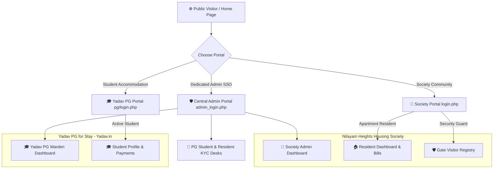
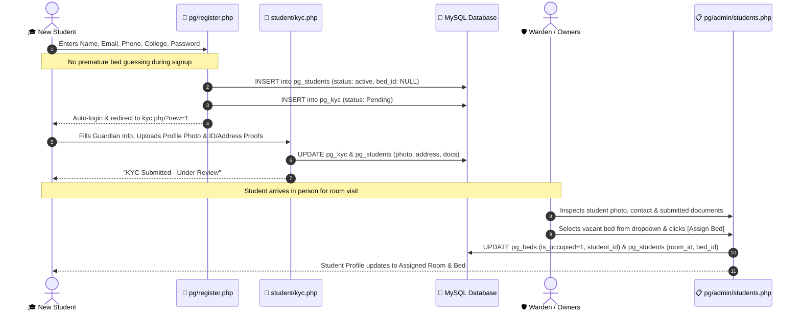

# 🏢 Nilayam Heights HMS & 🎓 Yadav PG for Stay (Yadav.in)

[](https://www.php.net/)
[](https://www.mysql.com/)
[](https://www.docker.com/)
[](https://threejs.org/)
[](scratch/test_all_features.php)
[](LICENSE)

> **🙏 जय श्री कृष्णा &bull; सर्वे भवन्तु सुखिनः सर्वे सन्तु निरामयाः &bull; Jai Shree Krishna 🙏**  
> *"Dedicated to harmonious, virtuous, and technologically advanced living under divine grace."*

---

## 📌 Executive Summary (For You & Your Team)

**Nilayam Heights HMS & Yadav PG** is an enterprise-grade, dual-property residential management and student coliving suite built with modern **PHP 8.4**, **MySQL 8.0**, and **Three.js WebGL**.

The platform seamlessly bridges two property models within a unified operational architecture:

1. **🏢 Nilayam Heights Housing Society**: A premier residential community featuring automated maintenance billing, dynamic utility calculations, a real-time gate security visitor registry, resident KYC verification, 24/7 AI resident assistant, and an interactive 3D digital-twin campus visualizer.
2. **🎓 Yadav PG for Stay (`Yadav.in`)**: A 4-floor student accommodation coliving facility featuring single, double, and triple sharing rooms, self-registration, 1-minute digital government KYC, student photo display, and a 1-click warden bed allocation desk.

---

## 👥 Property Leadership & Engineering

| Role | Name | Responsibilities |
| :--- | :--- | :--- |
| **Property Owners** | **Binod Yadav &amp; Sumit Yadav** | Property ownership, in-person room visits, custom stay terms &amp; fee agreements |
| **Lead Platform Architect** | **Yuvraj** | Full-stack engineering, security architecture, 3D WebGL twin, DevOps |
| **Society Admin &amp; PG Warden** | **Yuvraj** (`yuvrajyadav734@gmail.com`) | Day-to-day admissions, gate registers, KYC reviews, billing &amp; bed allocations |
| **Records Creator** | **Sumit Yadav** | Official property registrar &amp; resident creation authority |

---

## 🏗️ System Architecture & File Tree

```
Society-Management-System/
├── HMS-2/
│   ├── Includes/                     # System-wide core libraries & security middleware
│   │   ├── config.php                # Environment-aware database connection (MySQLi & PDO)
│   │   └── session.php               # Hardened RBAC authentication & BCrypt password engine
│   │
│   ├── admin/                        # 🏢 Housing Society Administrator Portal
│   │   ├── Dashboard/admin.php       # Society KPI metrics, 3D campus & quick-action sidebar
│   │   ├── pg_students.php           # 🌟 Cross-Property PG Student & Document Registry
│   │   ├── society_kyc.php           # 🌟 Resident KYC Review & Document Verification Desk
│   │   ├── Bill/                     # Maintenance billing engine & dynamic PDF/HTML invoices
│   │   ├── Announcement/             # Broadcast notices & community circulars
│   │   ├── Members/                  # Resident member directory & facility staff roster
│   │   ├── Home_Services/            # Society handyman & electrician service directory
│   │   ├── Event_calender/           # Community calendar & festival scheduler
│   │   └── Chat/ai_assistant.php     # 24/7 Society AI Assistant interface
│   │
│   ├── members/                      # 🏠 Housing Society Resident Portal
│   │   ├── Dashboard/member.php      # Resident self-service hub, noticeboard & ledger
│   │   ├── kyc.php                   # 🌟 Resident KYC: Flat ownership & ID proof upload
│   │   └── Bill/                     # Personal maintenance ledger & digital receipts
│   │
│   ├── staff/                        # 🛡️ Gate Security Guard Portal
│   │   └── Dashboard/staff.php       # Live visitor check-in, contractor registry & logs
│   │
│   ├── pg/                           # 🎓 Yadav PG for Stay Coliving Module (Yadav.in)
│   │   ├── login.php                 # Dedicated PG student & warden sign-in portal
│   │   ├── register.php              # Streamlined student sign-up (instant redirect to KYC)
│   │   ├── student/                  # Student Self-Service Suite
│   │   │   ├── profile.php           # Student profile, uploaded photo, bed info & terms
│   │   │   ├── kyc.php               # 🌟 Guardian & student KYC, Aadhaar & address proof uploads
│   │   │   ├── complaints.php        # Maintenance ticketing (+ Create complaint modal)
│   │   │   ├── vacate.php            # 30-Day digital vacate intimation notice
│   │   │   ├── announcements.php     # Broadcast notices from Owners Binod & Sumit Yadav
│   │   │   └── payments.php          # Payment history & deposit records
│   │   ├── admin/                    # Warden / PG Operations Desk
│   │   │   ├── dashboard.php         # Live room/bed occupancy KPI cards & matrix
│   │   │   ├── rooms.php             # Room sharing config & bed capacity tracking
│   │   │   ├── students.php          # 🌟 Student directory with photo thumbnails & full KYC modal
│   │   │   ├── complaints_mgmt.php   # Maintenance ticket resolution desk
│   │   │   └── vacate_mgmt.php       # Move-out settlement & deposit releases
│   │   └── uploads/                  # Secure student identity proofs & profile photos
│   │
│   ├── home/                         # 🌐 Public Glassmorphic Dual-Property Portal
│   │   ├── home.php                  # Interactive landing page with Sri Krishna showcase
│   │   ├── home.css                  # Responsive cyber-glassmorphism theme
│   │   └── futuristic_city_bg.jpg    # Panoramic smart city architectural backdrop
│   │
│   ├── images/
│   │   └── sri_krishna_modern.jpg    # 🌟 High-Definition Modern Sri Krishna Divine Artwork
│   │
│   ├── js/
│   │   ├── 3d_campus_hero.js         # Three.js r128 3D Digital Twin with orbit controls
│   │   ├── ambient_space.js          # Throttled 30 FPS starfield & particle background
│   │   └── vendor/three.min.js       # Localized standalone Three.js engine
│   │
│   ├── css/
│   │   ├── master_theme.css          # Unified dark-navy design system
│   │   └── boxicons/                 # Standalone icon library (zero external dependencies)
│   │
│   ├── admin_login.php               # 🌟 Dedicated Central Administrator Portal (SSO)
│   ├── login.php                     # Multi-role Society & Staff authentication
│   ├── register.php                  # Resident sign-up with instant redirect to KYC
│   └── hms.sql                       # Complete relational database dump
│
├── Dockerfile                        # Multi-stage production container configuration
├── docker-compose.yml                # Microservices orchestration (PHP 8.2 + MySQL 8.0)
├── .env.example                      # Environment variables template
├── .gitignore                        # Git exclusion rules
└── .dockerignore                     # Docker build context optimizations
```

---

## 🌟 Core Highlights & Recent Enhancements

### 1. 🛡️ Dedicated Central Administrator Portal (`admin_login.php`)
- **Standalone Security Endpoint**: Separate from standard member/student logins. Accessible via top navbar (`Admin Portal`) and direct links from all login pages.
- **Single Sign-On (SSO)**: One login grants simultaneous administrator privileges across both Society Admin and Yadav PG Warden.
- **Dynamic Portal Routing**: Allows the administrator to launch directly into:
  - *Society Dashboard*
  - *Yadav PG Warden*
  - *PG Students & KYC Registry*
  - *Society Resident KYC Review*

### 2. 🪪 Dual Digital KYC Engine

#### A. Society Resident KYC (`members/kyc.php` & `admin/society_kyc.php`)
- **Resident Form**: Upload profile picture, declare Flat / Unit Number, specify residency type (*Property Owner / Tenant / Family Member*), father/spouse name, emergency contact, and permanent address.
- **Document Proofs**: Upload Government ID Front & Back (Aadhaar / Voter ID / Passport) and Ownership / Lease / Utility bill documents.
- **Admin Review Desk**: Society Admin inspects submitted records, views photos/documents in full, and verifies or rejects with 1 click.
- **Instant Onboarding**: New residents registering at `register.php` are automatically logged in and redirected directly to `members/kyc.php?new=1`.

#### B. Student KYC & Document Verification (`pg/student/kyc.php` & `admin/pg_students.php`)
- **Guardian & Identity Proofs**: Captures Father Name & Mobile, Mother Name & Mobile, Permanent Address, Profile Photo, ID Proof Front/Back, and Address Proof Front/Back.
- **Direct Image Rendering**: When a student uploads their profile photo, it is displayed immediately on their profile and as a photo thumbnail in both Society Admin and PG Warden tables.
- **Full Document Modal**: Admin can inspect all 4 uploaded documents directly on screen.
- **Warden 1-Click Bed Allocation**: Bed selection was removed from sign-up; Warden allocates beds upon the student's in-person visit via an inline dropdown and modal.

### 3. 🎨 Modern Sri Krishna Divine Visual Showcase
- **Artistic Heritage**: Features a high-definition celestial portrait of **Bhagavan Sri Krishna** (`HMS-2/images/sri_krishna_modern.jpg`) with golden flute, glowing peacock feather, and radiant electric-blue halo.
- **Sacred Top Header**: Circular glowing Sri Krishna avatar on `home/home.php` alongside:  
  *`🙏 जय श्री कृष्णा • Jai Shree Krishna • Auspicious Living & Protection under Divine Grace 🙏`*
- **Hero & Login Banners**: Integrated with illuminated badges into `login.php`, `pg/login.php`, `pg/register.php`, and `admin_login.php`.
- **Divine Showcase Card**: Dedicated glassmorphic card on the home page with Sanskrit invocation (*“जय श्री कृष्णा • हरे कृष्ण”*) celebrating the campus ethos founded by **Binod Yadav & Sumit Yadav**.

### 4. 🛏️ Pure Student Accommodation Policy
- **Pure Living (No Food/Mess Provided)**: Focused strictly on high-quality student accommodation (**High-Speed Wi-Fi, RO Drinking Water, 24/7 Power Backup, and Daily Cleaning**). All mess/food tables and references have been removed.
- **Direct Owner Arrangements**: Room charges and security deposits are custom and arranged directly with **Owners Binod Yadav & Sumit Yadav** upon room visit (no fixed fees advertised).

### 5. 🌐 Modern 3D WebGL Campus Digital Twin
- **Three.js r128**: Interactive 3D digital-twin stage with drag-to-orbit controls.
- **Lighting Presets**: 1-click toggles between **Cyber Neon**, **Daylight**, and **Sunset**.
- **Camera Presets**: Instant focus jumps to **Nilayam Towers**, **Yadav PG Block**, or **Security Gate**.
- **Performance Capping**: Throttled to 30 FPS and automatically paused via `IntersectionObserver` when scrolled off-screen to preserve battery and GPU resources.

---

## 🔐 Enterprise Security Architecture (OWASP Hardened)

| Security Domain | Implementation Details |
| :--- | :--- |
| **SQL Injection (SQLi)** | **Zero raw SQL concatenation**. 100% converted to parameterized prepared statements (`mysqli_prepare()`, `mysqli_stmt_bind_param()`, `mysqli_stmt_execute()`). |
| **Password Storage** | **BCrypt hashing** (`PASSWORD_DEFAULT` with cost 12). Legacy plain-text passwords automatically upgrade to BCrypt upon first successful authentication. |
| **Cross-Site Scripting (XSS)** | All dynamic database outputs passed through `htmlspecialchars(..., ENT_QUOTES, 'UTF-8')`. |
| **Session Security** | `session.cookie_httponly = 1`, `session.cookie_samesite = 'Lax'`, and automatic `session_regenerate_id(true)` upon privilege escalation. |
| **Execution After Redirect (EAR)** | All authorization gates strictly terminate execution with `exit;` immediately following redirect headers. |
| **Role-Based Access Control** | Rigid segregation between `admin`, `member`, `staff`, and PG `student` roles. |

---

## 🚀 Quick Start & Deployment Guide

### Option A: 💻 Standalone Local Server (Mac / Linux / Windows)

#### 1. Prerequisites
- **PHP 8.0+** with `mysqli`, `pdo_mysql`, and `gd` enabled (`php -v`)
- **MySQL 8.0+** running on `localhost:3306`

#### 2. Configure Environment Credentials (.env.local)
```bash
# Copy the environment template for local development
cp .env.example .env.local

# Edit .env.local if your MySQL username, password, or port differs from defaults
# DB_HOST=localhost
# DB_PORT=3306
# DB_NAME=hms
# DB_USER=root
# DB_PASS=your_password_here
```
> [!NOTE]
> `.env.local` is strictly ignored by Git. Your passwords and credentials will never be exposed or pushed to GitHub.

#### 3. Import Database
```bash
mysql -u root -e "CREATE DATABASE IF NOT EXISTS hms;"
mysql -u root hms < "HMS-2/hms.sql"
```

#### 4. Start Development Server
```bash
php -S 127.0.0.1:8000 -t HMS-2
```

Navigate to:
👉 **[http://127.0.0.1:8000/home/home.php](http://127.0.0.1:8000/home/home.php)**

---

### Option B: 🐳 Local Docker Container Deployment

```bash
docker compose up -d --build
```

Access containerized endpoints:
- 🌐 **Landing Page**: [http://localhost:8080/home/home.php](http://localhost:8080/home/home.php)
- 🛡️ **Central Admin Portal**: [http://localhost:8080/admin_login.php](http://localhost:8080/admin_login.php)
- 🎓 **Yadav PG Portal**: [http://localhost:8080/pg/login.php](http://localhost:8080/pg/login.php)

---

### Option C: ☁️ 100% Free Cloud Deployment on Render (Zero Cost, No Credit Card)

You can host this entire platform in the cloud completely free of cost using **Render's Free Web Service Tier** combined with a **Free Cloud MySQL Database** (such as Aiven or TiDB Cloud):

#### 1. Create a 100% Free MySQL Database (No Credit Card)
1. Sign up for free at **[Aiven.io](https://aiven.io)** (or **[TiDB Cloud](https://tidbcloud.com)**).
2. Create a free MySQL database instance (Free Tier — 100% free forever, no payment details required).
3. Copy your database credentials:
   - `DB_HOST` (e.g. `mysql-xyz.aivencloud.com`)
   - `DB_PORT` (e.g. `12345`)
   - `DB_NAME` (e.g. `defaultdb` or `hms`)
   - `DB_USER` (e.g. `avnadmin` or `root`)
   - `DB_PASS` (your database password)
4. Open the SQL console or connect via MySQL CLI and import [`HMS-2/hms.sql`](HMS-2/hms.sql) into your database.

#### 2. Deploy Web Service on Render (Free Tier)
1. Log into **[render.com](https://render.com)** using your GitHub account (`Yuvionix`).
2. Click **New +** → **Web Service**.
3. Select your repository: **`Yuvionix/Nilayam-Heights-HMS`**.
4. Configure the settings:
   - **Name**: `nilayam-heights-hms`
   - **Language / Runtime**: `Docker` *(Render detects `Dockerfile` automatically)*
   - **Instance Type / Plan**: Select **`Free`** ($0 / month)
5. Under **Environment Variables**, add your cloud database credentials:
   - `DB_HOST` = `<your cloud host>`
   - `DB_PORT` = `<your cloud port>`
   - `DB_NAME` = `<your cloud db name>`
   - `DB_USER` = `<your cloud db user>`
   - `DB_PASS` = `<your cloud db pass>`
   - `APP_ENV` = `production`
6. Click **Create Web Service**.
7. Render will build the Docker container using dynamic port binding and issue your live HTTPS URL (e.g. `https://nilayam-heights-hms.onrender.com`)!

---

## 🔑 Default Credentials & Access Matrix

| Role | Username / Email | Password | Access Endpoint |
| :--- | :--- | :--- | :--- |
| **Central Administrator (SSO)** | `Yuvraj` | `password` | [`admin_login.php`](http://127.0.0.1:8000/admin_login.php) |
| **Society Admin** | `Yuvraj` *(or `yuvrajyadav734@gmail.com`)* | `password` | [`admin/Dashboard/admin.php`](http://127.0.0.1:8000/admin/Dashboard/admin.php) |
| **Society Resident Member** | `yuvrajyadav734@gmail.com` | `password` | [`members/Dashboard/member.php`](http://127.0.0.1:8000/members/Dashboard/member.php) |
| **Gate Security Guard** | `ramesh_guard` *(or `deepak.facility@gmail.com`)* | `password` | [`staff/Dashboard/staff.php`](http://127.0.0.1:8000/staff/Dashboard/staff.php) |
| **PG Student Resident** | `yuvraj` *(or `yuvrajyadav734@gmail.com`)* | `password` | [`pg/student/profile.php`](http://127.0.0.1:8000/pg/login.php) |
| **PG Warden / Tech Admin** | `Yuvraj` | `password` | [`pg/admin/dashboard.php`](http://127.0.0.1:8000/pg/login.php) |
| **Property Owners** | `Binod Yadav & Sumit Yadav` | In-Person | Direct stay agreements, pricing & room visits |

---

## 📊 Database Schema Reference

| Table Name | Description | Key Relationships |
| :--- | :--- | :--- |
| `admin` | Housing Society & PG Warden administrators | Primary key: `id` |
| `member` | Registered apartment residents | Foreign key to `bill.member_id` |
| `society_kyc` | Resident identity, flat ownership & document proofs | Scoped to `member.id` |
| `staff` | Gate security guards & facility personnel | Role authorization |
| `bill` | Utility & maintenance invoices | Scoped to `member.id` |
| `announcement` | Society broadcast notices | Posted by `admin` |
| `registry` | Live gate security entries | Logged by `staff` |
| `pg_rooms` | Hostel rooms across Floors 1–4 | Single, Double, Triple sharing types |
| `pg_beds` | Individual beds inside PG rooms | Joined with `pg_students.bed_id` |
| `pg_students` | Active & vacating student residents | References `pg_rooms` and `pg_beds` |
| `pg_kyc` | Government ID & Guardian records | One-to-one with `pg_students.id` |
| `pg_complaints` | Maintenance tickets raised by students | Status: `Pending` / `Resolved` |
| `pg_vacate_intimations` | 30-Day move-out intimations | Deposit settlement workflow |
| `pg_payments` | Digital rent receipts & transaction logs | Scoped to `pg_students.id` |

---

## 🔄 Visual Architecture & Workflow Diagrams (For the Team)

### 1. Dual-Property Multi-Role Operational Flow


### 2. Student Self-Registration & In-Person Bed Allocation Workflow


---

## 🛠️ Developer Runbook & Operations Guide

### A. How to Run the 20-Point Automated Verification Suite
Whenever code changes or database migrations are made, execute the audit test suite:
```bash
php scratch/test_all_features.php
```
*Expected Output: `20 PASSED, 0 FAILED` covering MySQL connection, RBAC accounts, KYC schemas, rebranding purity, and visual assets.*

### B. How to Allocate a Bed to a Student
1. Log in to the Admin Portal at `http://127.0.0.1:8000/admin_login.php` (User: `Yuvraj` / Pass: `password`).
2. Navigate to **PG Students & KYC** ([`admin/pg_students.php`](http://127.0.0.1:8000/admin/pg_students.php)).
3. Locate the student showing `Pending Allocation`.
4. Choose an available bed from the inline dropdown (e.g., `R-102 (Bed B)`) and click **Assign**.
5. The room and bed occupancy matrices update atomically across the database.

### C. How to Review & Verify Resident KYC
1. In Society Admin, click **Resident KYC** ([`admin/society_kyc.php`](http://127.0.0.1:8000/admin/society_kyc.php)).
2. Inspect the resident's profile picture, Flat number, Aadhaar card, and ownership/lease document.
3. Click **Verify** to grant official verified resident status, or **Reject** with remarks.

### D. How to Export a Clean Database Backup
```bash
mysqldump -u root --add-drop-table hms > "HMS-2/hms.sql"
cp "HMS-2/hms.sql" "hms.sql"
```

---

## 🧪 System & Security Audit Results

Our automated audit test suite validates every module across the database and codebase:

```text
=========================================================
🔍 FULL-STACK SYSTEM & FUNCTIONALITY AUDIT RESULTS
=========================================================
✅ [PASS] Database Connection (MySQLi)           ── Connected to database 'hms'
✅ [PASS] Society Admin Account (Yuvraj)          ── Verified admin user
✅ [PASS] Society Resident Member Account         ── Verified resident session
✅ [PASS] Security Guard Staff Account            ── Ramesh Kumar active
✅ [PASS] Society Billing & Invoicing Engine      ── 11 invoices, ₹35,500 total
✅ [PASS] Security Gate Visitor Registry          ── 5 gate entries logged
✅ [PASS] Community Announcements Engine          ── 4 active broadcasts
✅ [PASS] Yadav PG Rooms Matrix                   ── 8 rooms across 4 floors
✅ [PASS] Yadav PG Bed Capacity Tracking          ── 16 Beds (4 occupied, 12 vacant)
✅ [PASS] PG Student Resident Record              ── Yuvraj Yadav in R-406
✅ [PASS] Student KYC & Guardian Documentation    ── Father: Binod Prasad Yadav (Verified)
✅ [PASS] PG Maintenance Complaints Engine        ── Ticketing operational
✅ [PASS] 30-Day Digital Vacate Intimation Engine ── Settlement workflow active
✅ [PASS] PG Digital Receipts Ledger              ── 3 student receipts logged
✅ [PASS] Complete Brand Rebranding Audit         ── 0 legacy 'Kio' remnants
✅ [PASS] Domain Rebranding Audit                 ── 0 legacy 'prazo' remnants
✅ [PASS] Society Resident KYC System             ── society_kyc active & verified
✅ [PASS] Creator Identity Audit                  ── Sumit Yadav active, 0 Shyam
✅ [PASS] Dedicated Administrator Portal (SSO)    ── admin_login.php active
✅ [PASS] Modern Sri Krishna Visual Asset         ── 851 KB HD artwork active
=========================================================
📊 AUDIT TOTAL: 20 PASSED, 0 FAILED (100% HEALTHY)
=========================================================
```

---

## 👥 Engineering & Collaboration Guidelines

When contributing to this repository, please uphold these engineering standards:
1. **Security First**: Always use `mysqli_prepare()` with strict type-binding. Never interpolate variables directly into SQL queries.
2. **Output Hygiene**: Always escape dynamic user data with `htmlspecialchars(..., ENT_QUOTES, 'UTF-8')`.
3. **Session Integrity**: Guard every authenticated endpoint using `require_role()` or `require_pg_role()`.
4. **Preserve Cultural & Brand Identity**: Yadav PG operates under the brand **Yadav.in** & **Yadav PG for Stay**, honoring the sacred slogan **"जय श्री कृष्णा (Jai Shree Krishna)"**.
5. **Clear Commit Messages**: Follow Conventional Commits (`feat:`, `fix:`, `refactor:`, `docs:`, `security:`).

---

## 👤 Author & Platform Architect

- **Lead Full-Stack Developer & Platform Architect**: **Yuvraj**
- **Email**: [yuvrajyadav734@gmail.com](mailto:yuvrajyadav734@gmail.com)
- **Primary Stack**: PHP 8.4 &bull; MySQL 8.0 &bull; Three.js WebGL &bull; Docker &bull; JavaScript &bull; Linux Cloud
- **Property Owners**: **Binod Yadav &amp; Sumit Yadav**

---

## 📄 License
This software is distributed under the [MIT License](LICENSE).
